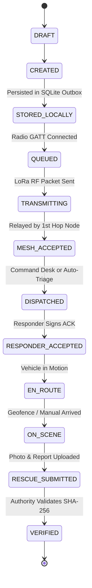

# UrSafe Production Architecture & System Design

## 1. System Overview & Philosophy

UrSafe (Cascade26) is a **resilient, offline-first emergency coordination and disaster communication system**. It guarantees that citizens can create, store, and transmit life-safety distress beacons without cellular coverage, internet connectivity, or central cloud infrastructure.

```text
                     URSAFE PLATFORM
                            |
        +-------------------+-------------------+
        |                   |                   |
     CITIZEN             RESPONDER          AUTHORITY
  MOBILE (Android)    MOBILE (Android)      WEB (TS/JS)
        |                   |                   |
        +-------------------+-------------------+
                            |
                     DOMAIN / PROTOCOL
                 (Protobuf, Rust Core)
                            |
                   +--------+--------+
                   |                 |
              LOCAL STATE       SYNC ENGINE
              (Room/SQLite)    (DTN / Outbox)
                   |                 |
                   +--------+--------+
                            |
                     TRANSPORT LAYER
                   +--------+--------+
                   |        |        |
                  BLE      USB      LoRa
                   |        |        |
                   +--------+--------+
                            |
                     MESHTASTIC MESH
                   (SX1262 LoRa 865MHz)
                            |
                   Field Relay Nodes
                            |
                 [OPTIONAL INTERNET / GRID]
                            |
                    CENTRAL BACKEND
                   (Node.js REST/WS)
                   +--------+--------+
                   |        |        |
                 Auth   Incidents   Sync
                   |        |        |
                   +--------+--------+
                            |
                  POSTGRESQL / SQLITE
```

---

## 2. Eight Core Subsystem Layers

| Layer | Responsibility | Primary Stack | Key Boundaries |
|---|---|---|---|
| **1. Citizen Field Mobile** | Panic SOS beaconing, progression tracking, dual-confirmation rescue co-signing | Kotlin, Jetpack Compose, Room | Interacts via local BLE / USB with LoRa companion radio |
| **2. Responder Field Mobile** | Nearby emergency triage, dispatch acceptance, turn-by-turn routing, evidence capture | Kotlin, Jetpack Compose, Room | Communicates via BLE with Heltec V3 / T-Beam |
| **3. Authority Command Web** | Geospatial incident dispatch, rescue verification desk, credential revocation, audit | TypeScript, HTML5, CSS, Leaflet | Consumes REST API Gateway & WebSocket stream |
| **4. Shared Protocol & Core** | Cryptographic envelope signing (Ed25519), vector clock CRDT merge, Protobuf wire serialization | Rust (`ursafe-core-rs`), Protobuf | FFI bindings to Kotlin via JNI and Python via PyO3 |
| **5. Local Persistence & Sync** | Durable outbox/inbox, conflict-free state merge, DTN bundle store | Room SQLite (Mobile), SQLite WAL (Console) | Survives app restarts, OS process death, power outages |
| **6. Radio Hardware & Transport** | LoRa RF transmission (865 MHz IN, 915 MHz US, 433 MHz EU), BLE GATT client/server | Meshtastic API, Nordic UART Service | Serial CDC / BLE GATT MTU 247 bytes |
| **7. Central Backend Control** | Multi-tenant RBAC, incident dispatch, W3C credentials, immutable audit chain | Node.js (v20+), PostgreSQL / SQLite | High-concurrency async I/O with WebSocket broadcast |
| **8. Research & Hazard Engine** | Flood advection modeling, dispatch optimization, NLP triage calibration | Python 3.13, NumPy, SciPy | Batch analytics, simulation, and red-team fuzzing |

---

## 3. Strict Identity Disambiguation (Section 40)

To eliminate ambiguity across field telemetry, UrSafe enforces strict entity separation:

```text
PERSON (Human Actor)
  └── Example: Priya Sharma / Capt. Vikram Singh
ACCOUNT (Credentialed Subject)
  └── Example: usr-citizen-01 / usr-responder-01
PHONE (Host Client Hardware)
  └── Example: Pixel 10 / Samsung Galaxy XCover 6 Pro
RADIO (Companion Transceiver Hardware)
  └── Example: Heltec WiFi LoRa 32 V3 (ESP32-S3 + Semtech SX1262)
MESH NODE (RF Topology Node ID)
  └── Example: !4a91c28f (Meshtastic 32-bit Node ID)
```

A user account is never coupled 1:1 to a physical radio. A tactical responder can pair with any available field radio; the software cryptographic handshake establishes verified attribution.

---

## 4. End-to-End Emergency Progression State Machine (Section 25)

The life-safety SOS lifecycle moves through deterministic states:



### Critical Non-Negotiables:
- **No Instant Closure:** Responders are cryptographically prevented from closing incidents with a single button tap. Every rescue requires structured reporting and SHA-256 hashed evidence (Section 27).
- **Dual Confirmation:** Citizens co-sign the rescue confirmation receipt upon successful extraction, creating non-repudiable audit evidence (Section 28).
