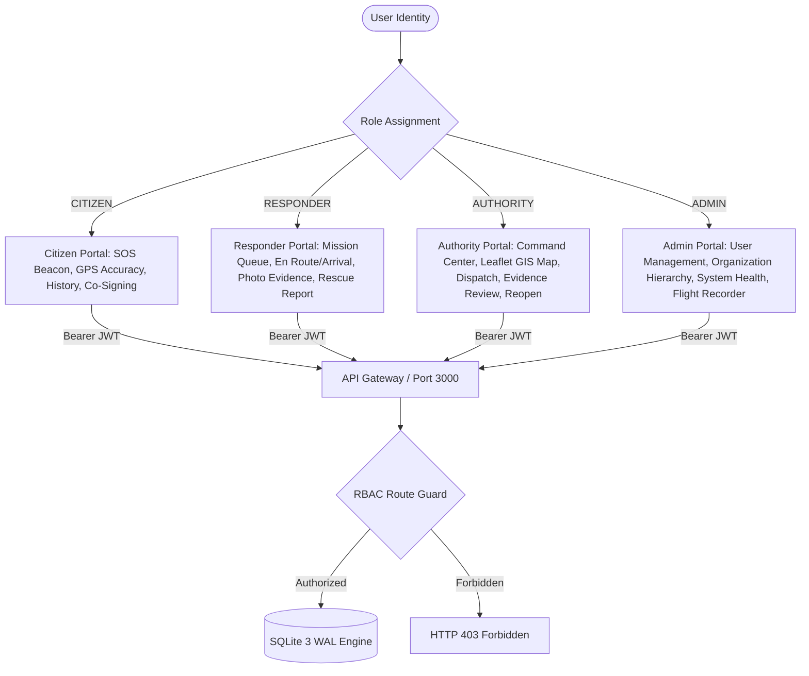
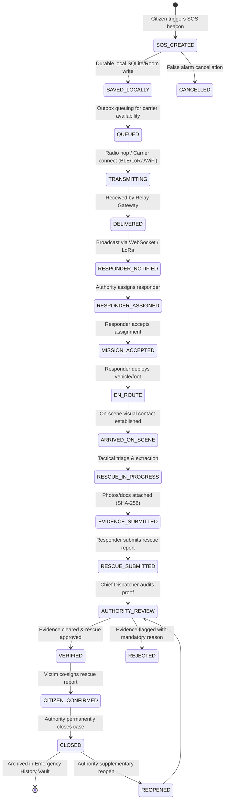
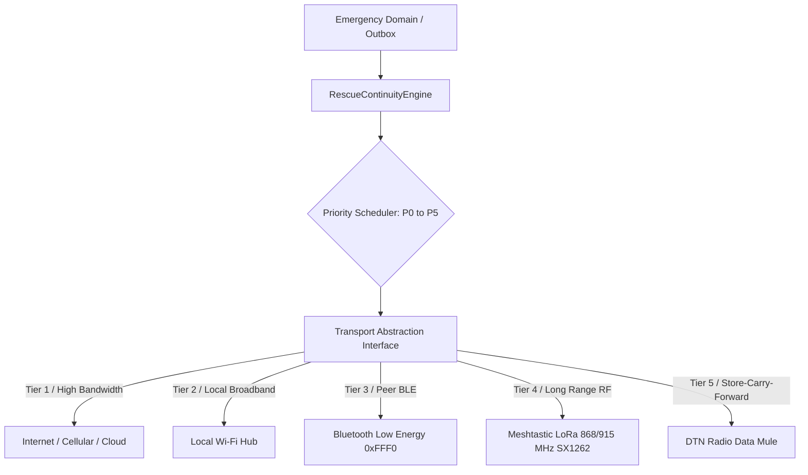

# UrSafe Current System Architecture & Technical Specification

**Document:** `docs/ARCHITECTURE_CURRENT.md`  
**System Classification:** Greenfield Offline-First Emergency Communication & Coordination Platform  
**Target Architecture:** Heterogeneous Edge/Mesh/Cloud Hybrid  
**Audit Date:** 2026-10-26  

---

## 1. Monorepo Structure

```text
.
├── apps/
│   ├── api/                    # Central & Edge Coordination REST API Gateway & SQLite engine
│   │   ├── auth.js             # HMAC-SHA256 tokens, PBKDF2/SHA256 hashing, RBAC guards
│   │   ├── db.js               # Synchronous SQLite 3 DatabaseSync interface with WAL mode
│   │   └── server.js           # 38 REST endpoints, WebSocket hub, 18-state lifecycle engine
│   ├── web-console/            # Four-role tactical coordinator web portal
│   │   ├── index.html          # Semantic HTML5 shells for Citizen, Responder, Authority, Admin
│   │   ├── app.js              # State management, Web Crypto SHA-256, Web Bluetooth, Leaflet GIS
│   │   ├── styles.css          # Custom dark-mode design system & fluid responsive layout
│   │   └── server.js           # Static web file server & reverse API/WebSocket proxy
│   ├── victim-android/         # Kotlin Android SOS client with Room DB & BLE GATT service
│   └── responder-android/      # Kotlin Android Tactical Responder application
├── packages/
│   ├── audit/                  # Cryptographic SHA-256 immutable flight recorder ledger
│   ├── crdt/                   # LWW-Register, OR-Set, Vector Clocks for partition convergence
│   ├── crypto/                 # Ed25519 digital signatures, X25519 ECDH, ChaCha20-Poly1305 AEAD
│   ├── domain/                 # Canonical Incident, Responder, Evidence domain entities
│   ├── protocol/               # Binary Protobuf envelope wire codec (168-byte MTU compliance)
│   ├── routing/                # Geographic flood & opportunistic DTN bundle routing
│   ├── sync/                   # Store-and-forward outbox & synchronization engine
│   └── ursafe-core-rs/         # High-performance Rust cryptographic and CRDT core
├── services/
│   ├── credential/             # W3C Verifiable Credential issuer & revocation registry
│   ├── dispatch/               # Multi-objective responder scoring & assignment engine
│   ├── hazard/                 # Kinematic hazard expansion buffer & zone alerts
│   ├── nlp/                    # Multilingual Hindi/Hinglish/English emergency triage extraction
│   ├── receipts/               # Dual-signed cryptographic rescue receipts
│   └── trust/                  # Multi-factor trust graph & Sybil defense models
├── hardware/
│   ├── ble/                    # Web Bluetooth API & Python Bleak GATT peripheral driver (0xFFF0)
│   ├── meshtastic/             # Meshtastic serial transceiver interface (SX1262 LoRa PHY)
│   └── simulator/              # Deterministic RF channel & mesh topology simulator
├── infrastructure/
│   ├── docker-compose.yml      # Multi-service containerized deployment spec
│   └── migrations/             # SQL schema migrations (001_initial_schema.sql, 002_product_completion.sql)
├── contracts/
│   ├── messages.proto          # Authoritative Protobuf wire protocol definition
│   └── openapi.yaml            # OpenAPI 3.0 REST specification
├── docs/                       # Architectural specs, QA reports, protocol runbooks
└── tests/                      # 81 automated tests (unit, integration, security RBAC, lifecycle)
```

---

## 2. Four-Role User & Identity Architecture

UrSafe enforces strict cryptographic role separation at both API and UI boundaries:



### Identity Disambiguation Principles
- **A device is not a user:** A phone (`dev-bt-01`) has its own hardware identity distinct from the logged-in session (`usr-citizen-01`).
- **Bluetooth connection is not authentication:** Pairing a peripheral establishes transport link security, not operational role authorization.
- **A responder credential is not a session:** A tactical ALS credential (`NDRF-B-108`) is an independently signed verifiable credential, validated separately from the login JWT.

---

## 3. Canonical Emergency Domain Entity

Every emergency incident in the system contains the following immutable schema fields:

```json
{
  "incidentId": "inc-mvo89tjs-466",
  "createdAt": 1792956400000,
  "updatedAt": 1792956600000,
  "createdBy": "usr-citizen-01",
  "creatorDeviceId": "dev-bt-01",
  "category": "FLOOD",
  "urgency": "CRITICAL",
  "severity": "HIGH",
  "description": "Rising floodwaters trapped 3 persons on rooftop",
  "language": "hi-IN",
  "peopleAffected": 3,
  "location": {
    "latitude": 28.650812,
    "longitude": 77.230041,
    "accuracy_m": 8.5,
    "locationTimestamp": 1792956395000,
    "reverseAddress": "Chandni Chowk, Old Delhi, Delhi, 110006, India"
  },
  "status": "SOS_CREATED",
  "priority": "P0_LIFE_CRITICAL",
  "assignedResponder": {
    "id": "usr-responder-01",
    "name": "Capt. Vikram Singh",
    "badge": "NDRF-B-108"
  },
  "communicationState": {
    "carrier": "BLE",
    "activePaths": 2,
    "lastAckAt": 1792956405000
  },
  "hazardState": {
    "activeHazardsNearby": 1,
    "floodBufferMeters": 350
  },
  "evidenceState": {
    "filesCount": 1,
    "sha256": "e3b0c44298fc1c149afbf4c8996fb92427ae41e4649b934ca495991b7852b855",
    "verificationStatus": "VERIFIED"
  },
  "verificationState": "AUTHORITY_VERIFIED",
  "syncState": "SYNCHRONIZED",
  "closedAt": null
}
```

---

## 4. Complete 18-State Emergency Lifecycle State Machine



---

## 5. Transport Abstraction Layer & Priority Hierarchy

UrSafe decouples the emergency domain from physical networking through the `Transport` interface:



### Message Priority Scheduler
- **P0 — Life Critical:** Distress beacons, medical emergencies, evacuation commands (never dropped or delayed).
- **P1 — Rescue Operation:** Responder assignments, on-scene arrivals, status updates.
- **P2 — Safety & Hazards:** Hazard zone polygon alerts, weather warnings.
- **P3 — Operational:** Rescue reports, evidence uploads, verification clearance.
- **P4 — Telemetry:** Node battery status, RSSI/SNR metrics, heartbeat pulses.
- **P5 — Non-Critical:** CRDT delta synchronization, background historical sync.

---

## 6. Durable Persistence & Partition Healing

- **Central & Local Server:** SQLite 3 via `DatabaseSync` (`node:sqlite`) operating in Write-Ahead Logging (WAL) mode (`data/ursafe_production.db`). Synchronous disk writes guarantee zero data loss across process termination or machine reboot.
- **Mobile Edge:** Android Room SQLite database caching outbox packets, mesh node topologies, and user profiles.
- **Partition Healing via CRDT:** State divergence across disconnected network islands resolves deterministically via:
  - **LWW-Register (Last-Write-Wins):** For scalar telemetry (battery, responder status) using hybrid logical clocks.
  - **OR-Set (Observed-Remove Set):** For concurrent hazard listings and responder assignments.
  - **Vector Clocks:** Tracks causality and event ancestry across multi-hop data mules.

---

## 7. Cryptographic & Verification Subsystem

- **Bearer Authentication:** HMAC-SHA256 tokens with configurable secrets and expirations.
- **Password Security:** PBKDF2 with SHA-256 and unique 16-byte random salts.
- **Evidence Integrity:** 256-bit SHA-256 digests computed at capture time; duplicate uploads rejected via HTTP 409 Conflict.
- **Wire Signatures:** Ed25519 digital signatures on protobuf envelopes via Rust `ed25519-dalek`.
- **Flight Recorder Hash Chain:** Continuous cryptographic chain where:
  $$\text{Hash}_n = \text{SHA256}(\text{Hash}_{n-1} + \text{Payload}_n + \text{Timestamp}_n + \text{ActorId}_n)$$
  Any retroactive tampering breaks subsequent hashes and is caught during audit verification.

---

## 8. Real Geographic GIS & Location Subsystem

- **Real GNSS:** Browser HTML5 Geolocation API / Android FusedLocationProvider querying real hardware GPS coordinates.
- **Honest Accuracy Radius:** Coordinates are accompanied by an accuracy radius badge (e.g. `±8.5m`) and acquisition timestamp.
- **Persistent Reverse Geocoding:** OpenStreetMap Nominatim reverse geocoding resolves coordinates to street addresses, persistently cached in SQLite table `geocache` for offline lookup.
- **Leaflet GIS Map:** Vector layer rendering real world geography, zooming, panning, and distinct pin styling (Red Victim, Blue Responder, Hazard Polygon).
