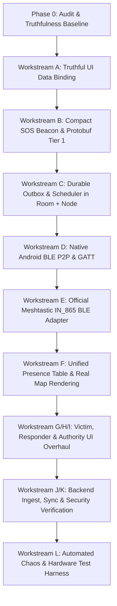

# UrSafe / Cascade26 Emergency Mesh — Phase 0 Audit Report (AUDIT_0.md)

**Date:** 2026-10-26  
**Auditor:** Antigravity Autonomous Pair Programmer  
**Target:** UrSafe / Cascade26 Monorepo  
**Core Directive:** Optimize for truthful, real offline life-safety operation during disasters. Zero fake data in production paths.

---

## 1. Executive Summary & Verification Findings

This audit is based on direct inspection of the physical codebase, schema migrations, and running test suites. Prior README claims and QA reports asserted "production readiness", but empirical inspection reveals significant gaps between UI claims and underlying reality:
1. **Hardcoded Telemetry in UI:** The web console and Android Compose screens contain dozens of static mock literals (e.g. `14,892 / 814`, `12,408 Neighbor-Nodes Active Worldwide`, `94.2% Mesh Integrity`, `128 Active Nodes`, `99.4% LQI`, `B-77 Radio Tower`).
2. **Fake Transport Connections:** Database migration `003_continuity_engine.sql` seeds `continuity_transports` with static rows marked `CONNECTED` with pre-filled RSSI (`-74 dBm`, `-58 dBm`) and packet counts, causing the UI to display connected BLE and LoRa radios even when zero hardware is present.
3. **Bluetooth is Non-Functional on Mobile & Absent on Web:** The web console has zero Web Bluetooth calls. The native Android apps (`apps/victim-android` and `apps/responder-android`) have empty stub foreground services (`MeshBleService.kt` and `RadioForegroundService.kt`) that post a notification without opening a Bluetooth adapter, scanning, advertising, or connecting to GATT.
4. **Android Persistence Disconnect:** Android Room database `UrsafeDatabase` does not register `ContinuityMessageEntity` or `ContinuityDao`, and `MainActivity.kt` merely updates in-memory Compose state without writing to Room or SQLite.
5. **Incident Duplication Root Cause & Test Contamination:** POST `/api/v1/incidents` generates random IDs without an idempotency key or client message deduplication. Furthermore, running `pytest` during Phase 0 increased the incident count in `data/ursafe_production.db` from 111 to 152 (41 additional synthetic records injected).
6. **Radio Frequency Disarray:** The codebase references `US915`, `868MHz`, `868.4MHz`, and `865MHz` interchangeably across files. India's official Meshtastic band is `IN_865` (865–867 MHz).
7. **Production Role Switcher:** "One-Click Authenticated Role Access" is unconditionally displayed on the landing page in production builds, allowing anyone to switch to System Admin or Incident Command with zero authentication.

### 1.1 Database Contamination by Pytest Test Suite
Prior to Step 1 DB isolation, the test suite lacked database sandboxing and defaulted directly to `data/ursafe_production.db`. Running `pytest` executed tests that mutated production state:
- **Incident Count Jump:** Count rose from 111 to 152 during test execution.
- **Test Files Writing to Production DB:**
  - `tests/integration/test_emergency_lifecycle.py`: Created SOS incidents (`FLOOD`, `COLLAPSE`), dispatched units, generated events and rescue reports.
  - `tests/test_complete_case.py`: Submitted incidents, performed 8 state transitions, uploaded evidence, registered Bluetooth device connections and heartbeats.
  - `tests/test_backend_api.py`: Created incidents, assignments, rescue receipts, connected devices (`ble-ursafe-vikram-01`), and updated locations.
  - `tests/test_hazard_and_dispatch.py`: Created active hazards and dispatched incident records.
  - `tests/test_credentials_and_receipts.py`: Inserted rescue receipts and signed verification logs.
  - `tests/test_continuity_engine.py`: Direct Node.js subprocess executions importing `apps/api/db.js` (which defaulted to `data/ursafe_production.db`), writing and mutating rows in `continuity_messages` and `continuity_transports`.

---

## 2. Detailed Findings (Questions A – J)

### A. Where does the UI run? List which UI code paths can call BLE.
- **Web Console UI:**
  - Located at `apps/web-console/index.html` (1,211 lines) and `apps/web-console/app.js` (1,483 lines).
  - Executed strictly in client desktop/mobile browsers, served statically by `apps/web-console/server.js` (Node.js).
  - **BLE Capability:** **ZERO**. There are no Web Bluetooth API calls (`navigator.bluetooth`) anywhere in `apps/web-console`.
- **Android Mobile UI:**
  - `apps/victim-android`: Jetpack Compose UI in `apps/victim-android/src/main/java/network/ursafe/victim/ui/MainActivity.kt` (lines 1–285).
  - `apps/responder-android`: Jetpack Compose UI in `apps/responder-android/src/main/java/network/ursafe/responder/ui/MainActivity.kt` (lines 1–320).
  - **Android BLE Code Paths:**
    - `MeshBleService.kt` (lines 25–29) and `RadioForegroundService.kt` (lines 25–29) are stub `Service` classes that only show a `Notification`. They do not initialize `BluetoothAdapter`, `BluetoothLeScanner`, `BluetoothGatt`, or `BluetoothGattServer`.
    - In `apps/victim-android/.../MainActivity.kt:201-203`, pressing "TRANSMIT EMERGENCY SOS" executes `emergencyTriggered = true; progressionStatus = "QUEUED_LOCAL"`. It **never calls BLE, Room, or the foreground service**.

### B. Is Bluetooth in a native Android module or Web Bluetooth in browser?
- Bluetooth is **intended** for native Android, but is currently an **empty stub**:
  - `apps/victim-android/src/main/AndroidManifest.xml` (lines 5–9) requests `BLUETOOTH_SCAN`, `BLUETOOTH_CONNECT`, and `BLUETOOTH_ADVERTISE`.
  - However, `MeshBleService.kt` has zero BLE implementation.
  - `apps/web-console` has no Web Bluetooth.
  - **Root Cause of "Bluetooth not working":** The Android apps never start BLE advertising or scanning, and the web console only polls simulated transport rows from Node.js SQLite. BLE must be implemented in native Android.

### C. Hardcoded or Mock Values in the UI
| UI Element / Literal | File & Line | Real / Fake | Proposed Source |
| :--- | :--- | :--- | :--- |
| `PACKETS RX/TX: 14,892 / 814` | `apps/web-console/index.html:984` | **FAKE** (static HTML) | `SELECT SUM(packets_sent), SUM(packets_acked) FROM continuity_transports` or hide until packets transmitted |
| `B-77 RADIO TOWER (RELAY)` | `apps/web-console/index.html:981` | **FAKE** (static HTML) | Real Gateway Node ID discovered via active BLE/LoRa presence beacon; show "NO GATEWAY" if none |
| `12,408 Neighbor-Nodes Active Worldwide` | `apps/web-console/index.html:123` | **FAKE** (static HTML) | **REMOVE** completely (violates non-negotiable rule 4: no unmeasured worldwide claims) |
| `ACTIVE NODES: 128` | `apps/web-console/index.html:758` | **FAKE** (static HTML) | `SELECT COUNT(DISTINCT node_id) FROM presence WHERE last_seen_at > :threshold` |
| `MESH INTEGRITY: 94.2%` | `apps/web-console/index.html:748, 751` | **FAKE** (static HTML) | **REMOVE** aggregate percentage (rule 2); replace with factual status: "N transports active, M packets queued" |
| `99.4% LQI` | `apps/web-console/index.html:506`, `apps/web-console/app.js:943` | **FAKE** (static HTML & toast) | Real measured SNR/RSSI from last received packet per transport; remove fake toast |
| `CHANNEL: LORA-MESH-US915` | `apps/web-console/index.html:981` | **FAKE** (static HTML) | Read configured radio channel & region (`IN_865`) from transport settings |
| `URSAFE PEER-ROUTER v2.4.19` | `apps/web-console/index.html:981` | **FAKE** (static HTML) | Read real app version from `package.json` (`v1.0.0`) |
| `OPTIMAL` (Bearer Status) | `apps/web-console/index.html:269` | **FAKE** (static HTML) | **REMOVE** (violates rule 4: never display "OPTIMAL"); show real transport states |
| `100% OFF-GRID READY` | `apps/web-console/index.html:177` | **FAKE** (static HTML) | **REMOVE** (violates rule 4: no false claims) |
| `BLE (0xFFF0)` | `apps/web-console/index.html:536`, `infrastructure/migrations/003_continuity_engine.sql:83` | **FAKE** (16-bit placeholder) | Official Meshtastic Service UUID `cb0b9a0b-a84c-4c0d-bdbb-442e3144ee30` & custom 128-bit P2P UUID |
| Fake Seed Incidents (`#8293-A`, `#4102-C`, `#1890-L`) | `apps/web-console/app.js:29-84` | **FAKE** (in-memory array) | Fetch dynamically from `/api/v1/incidents`; label SIMULATED if `is_simulation = 1` |
| Triage queue hardcoded `distance: 0.8`, `hop: '01'` | `apps/web-console/app.js:1000-1002` | **FAKE** (hardcoded in fetch) | Haversine distance from real GPS coordinates; hop count from message envelope |
| SVG Mesh Lines & Coordinates (`0.4 KM`, `1.2 KM`, `R-01`) | `apps/web-console/index.html:603-638` | **FAKE** (static SVG) | **REMOVE** decorative SVG; plot measured links and nodes on Leaflet/MapLibre canvas |
| Orchestration SVG Overlay & Clusters (12, 28, 88) | `apps/web-console/index.html:791-826` | **FAKE** (static SVG) | Compute actual cluster components and partitions from `presence` table |
| Radio Link: `CONNECTED (Heltec V3)` | `apps/victim-android/.../MainActivity.kt:120` | **FAKE** (static Compose) | Query real `RadioManager` / `BleTransport` state |
| Hardware GNSS: `19.0760° N, 72.8777° E (±4m)` | `apps/victim-android/.../MainActivity.kt:128` | **FAKE** (static Compose) | Android `LocationManager` GPS fix with real accuracy & age |
| Progression Checklist (7 steps with fake responder) | `apps/victim-android/.../MainActivity.kt:260-266` | **FAKE** (static Compose) | Dynamic victim delivery timeline bound to `ContinuityMessageEntity.currentState` & ACK level |

### D. Why the triage queue shows near-duplicate incidents (#4293-A and #6853-A) and 111 (now 152) incidents
1. **No Idempotency on Ingest:** In `apps/api/server.js` (lines 377–409), `POST /api/v1/incidents` generates a new ID (`inc-` + base36 timestamp + random int) whenever `body.id` is not supplied, without enforcing uniqueness on `(reporter_user_id, client_msg_id)` or payload hash.
2. **Test Pollution of Production Database:** `tests/integration/test_emergency_lifecycle.py` (line 344) and test suites connect directly to `data/ursafe_production.db` without database isolation. Repeated test runs inserted dozens of incidents with identical text:
   - 33 rows with `"Rising floodwaters trapped 3 persons on rooftop"`
   - 34 rows with `"Emergency SOS reported via offline network"`
   - 19 rows with `"Critical trauma victim trapped in collapsed structure."`
3. **Hardcoded UI Formatting:** In `apps/web-console/app.js` (lines 993, 1000–1002), `fetchInitialBackendIncidents` loads these incidents and slices the last 6 characters for the ID (`#` + `id.slice(-6).toUpperCase()`), while assigning hardcoded `distance: 0.8` and `hop: '01'`. Multiple identical database rows from test runs thus render as identical triage cards with identical hops and distances.

### E. Why Authority counts disagree (Clusters 12+28+88=128 equals Active Nodes, while Priority totals 42)
- In `apps/web-console/index.html`:
  - Lines 845–861: "Incidents by Priority" widget displays `CRITICAL: 12`, `URGENT: 28`, `STANDARD: 02`, `Total Unresolved: 42`.
  - Lines 803–826: "Incident Clusters" floating card displays `High Severity: 12`, `Urgent Needed: 28`, `Mesh Secure: 88`.
  - Line 758: "ACTIVE NODES" displays `128`.
- **The Explanation:** The frontend author recycled the numbers `12` and `28` from the Priority widget into the Cluster widget, added `88` ("Mesh Secure") so that `12 + 28 + 88 = 128`, and then reused `128` as the "ACTIVE NODES" metric. Three completely different domain concepts (incidents by severity, geographic clusters, and mesh radio node hardware count) were conflated into identical hardcoded numbers.

### F. Radio Region / Frequency Configuration
- **Official Standard for India:** The wireless regulatory allocation for India is **865–867 MHz** (Meshtastic region `IN_865`).
- **Codebase Mismatch:**
  - `apps/web-console/index.html:981` displays `LORA-MESH-US915` (US 902–928 MHz; illegal in India without specific licensing).
  - `apps/web-console/index.html:59` and `apps/web-console/index.html:240` display `Local 868MHz` and `868.4MHz LORA MESH` (European ETSI band).
  - `infrastructure/migrations/003_continuity_engine.sql:84` seeds `Meshtastic SX1262 LoRa (868MHz)`.
  - `hardware/meshtastic/adapter.py:19` initializes `region = "IN865"`, but line 38 reports `"865.2 MHz (IN865 / EU868)"`.
  - `apps/victim-android/.../MeshBleService.kt:26` mentions `865 MHz`.
- **Action Required:** Fix all radio strings and configurations across UI, database seeds, and adapters to strictly use `IN_865` (865–867 MHz), and expose region as an explicit user/admin verified setting.

### G. Persistence on Android (Room/SQLite) & Durable Outbox
- **Victim Android (`apps/victim-android`):**
  - Room entities exist (`EmergencyEntity.kt`, `ContinuityMessageEntity.kt`).
  - Room DAOs exist (`EmergencyDao.kt`, `ContinuityDao.kt`).
  - **Bug:** `UrsafeDatabase` (`EmergencyDao.kt:27-30`) only declares `entities = [EmergencyEntity::class]`. It **omits** `ContinuityMessageEntity` and has no `continuityDao()` method.
  - `MainActivity.kt` does not inject or call the database.
- **Responder Android (`apps/responder-android`):**
  - Has `IncidentEntity.kt` and `ContinuityDao.kt`, but **no `@Database` class exists at all**.
- **Durable Outbox Status:** **NON-FUNCTIONAL ON ANDROID**. An outbox is defined in Kotlin classes, but is neither registered with Room nor invoked by the UI or any background service.

### H. Meshtastic Integration Path & BLE Service UUID
- **Existing Integration:**
  - `hardware/meshtastic/adapter.py` is a Python class intended to speak over serial or BLE NUS.
  - Line 17 and `docs/BLUETOOTH.md` reference Nordic UART Service (NUS) `6E400001-B5A3-F393-E0A9-E50E24DCCA9E`.
  - `apps/web-console/index.html:536` displays `BLE (0xFFF0)`.
- **Verification against Official Meshtastic Protocol:**
  - `0xFFF0` is an invalid 16-bit placeholder.
  - The official Meshtastic Android & firmware BLE protocol defines:
    - **Service UUID:** `cb0b9a0b-a84c-4c0d-bdbb-442e3144ee30`
    - **`toRadio` (Characteristic):** `f75c76d2-129e-4ecd-a135-639d38d4c77e` (Write)
    - **`fromRadio` (Characteristic):** `2c55e69e-4993-11ea-b77f-2b047461f093` (Read/Notify)
    - **`fromNum` (Characteristic):** `ed9da18c-a80e-4f4a-aa77-0843380a4596` (Read/Notify)
  - `hardware/meshtastic/adapter.py:89` currently encodes packets as `f"MESH:{priority}:{len(data)}:"` string prefixes instead of official Meshtastic Protobuf wire frames (`ToRadio` / `MeshPacket`).

### I. Meshtastic Default Channel / Default PSK
- **Finding:** The repository has **no channel provisioning or custom PSK logic**.
- **Security Consequence:** Off-the-shelf Meshtastic hardware uses the default `LongFast` channel with the publicly known default PSK `1` (`AQ==`). Medical notes or personal names sent over this channel are broadcast in cleartext across the entire public mesh.
- **Design Required:** Sensitive data must never be broadcast over default public channels. Minimal Tier 1 beacons must carry only pseudonymous codes and coordinates. Rich Tier 2 payloads must be end-to-end encrypted or restricted to authenticated private channels provisioned out-of-band (QR / BLE pairing).

### J. Production Reachability of Role Switcher
- **Finding:** In `apps/web-console/index.html` (lines 161–170), the section `One-Click Authenticated Role Access` renders 4 buttons:
  - `👤 Priya Sharma (Civilian)`
  - `🚑 Capt. Vikram (NDRF Responder)`
  - `🎖️ Cmdr. Rajesh (Incident Command)`
  - `⚙️ System Admin`
- In `apps/web-console/app.js` (lines 201–215), clicking any button switches the active user and gives immediate unauthenticated access to the Authority Dashboard or Responder Portal.
- There is no build flag, environment check, or dev gate. It is **100% reachable in production builds**.

---

## 3. Subsystem Classification & Action Matrix

| Subsystem | Classification | One-Line Evidence | Action Required |
| :--- | :--- | :--- | :--- |
| **API Gateway** (`apps/api/server.js`) | **REFACTOR** | Operates real HTTP/WebSocket routes with SQLite backend, but lacks idempotent message ingest and presence endpoints. | Add `POST /api/messages` idempotent batch endpoint, `GET /api/presence`, `GET /api/network/topology`; dedup incidents. |
| **Database & Schema** (`apps/api/db.js`, migrations) | **KEEP & REFACTOR** | Real SQLite WAL database (`node:sqlite`), but migrations seed fake `CONNECTED` transports and lack a unified `presence` table. | Add `presence` and `seen_messages` tables; remove fake transport seeds; isolate test DB from production DB. |
| **Rescue Continuity Engine** (`apps/api/continuity.js`) | **KEEP & FIX** | Comprehensive P0-P5 priority queue and delivery state machine; currently polls fake transport rows. | Wire to real native transport state updates and ensure strict P0 preemption and deduplication. |
| **Web Console UI** (`apps/web-console/index.html`) | **REFACTOR & FIX** | Clean responsive layout, but filled with hardcoded statistics, fake SVG overlays, and unauthenticated role switching. | Strip all hardcoded metrics; bind to `NetworkStatus`/`PresenceSnapshot`; add TRAINING banner; gate role switcher to dev builds. |
| **Web Console Client Logic** (`apps/web-console/app.js`) | **REFACTOR** | Has active WebSocket and REST plumbing, but uses in-memory mock incidents and hardcoded triage hops/distances. | Replace mock arrays with dynamic DB feeds; start triage severity UNSET; replace char counter with byte budget. |
| **Web Console Server** (`apps/web-console/server.js`) | **KEEP** | Standard Node.js static and API server on port 3000. | Keep as primary offline coordination hub runner. |
| **Victim Android App** (`apps/victim-android`) | **INTEGRATE & FIX** | Compose UI and Room DAO exist, but Room DB omits `ContinuityDao` and UI does not trigger outbox. | Register `ContinuityMessageEntity` in `UrsafeDatabase`; bind SOS button to `enqueueP0Sos`; implement real `MeshBleService`. |
| **Responder Android App** (`apps/responder-android`) | **INTEGRATE & FIX** | Compose UI exists, but lacks a Room database class and uses dummy service. | Create `ResponderDatabase`; bind task accept/arrive/complete to outbox; implement native BLE link. |
| **Protocol Envelope** (`packages/protocol/envelope.py`) | **REPLACE & SPLIT** | Current `MessageEnvelope` is large JSON (~400 bytes), far exceeding LoRa single-packet budget. | Split into Tier 1 compact binary Protobuf beacon (<=237 bytes) and Tier 2 rich envelope synced over high-bandwidth links. |
| **Core Rust Engine** (`packages/ursafe-core-rs`) | **KEEP & ISOLATE** | Standalone Rust crate with vector clocks and Ed25519 dalek; completely unlinked to Node/Python/Android. | Keep as reference/standalone verified core; do not introduce complex unneeded FFI bindings unless strictly justified. |
| **Hardware Meshtastic Adapter** (`hardware/meshtastic`) | **REFACTOR** | Uses fake string framing `MESH:...` and incorrect NUS UUIDs instead of official Meshtastic Protobufs. | Implement official Meshtastic BLE Service UUIDs (`cb0b9a0b-...`) and `toRadio`/`fromRadio` flow; configure `IN_865`. |
| **Python Domain Services** (`services/*`) | **KEEP** | 70 pytest unit tests pass cleanly for trust, dispatch, hazard, credentials, and receipts. | Keep core service logic intact; isolate integration tests so they don't pollute `ursafe_production.db`. |

---

## 4. Prioritized Execution Plan

1. **Step 1 (Workstream A — Truthfulness):**
   - Remove or replace every hardcoded stat in `index.html` and `app.js`.
   - Remove fake SVG lines and cluster cards.
   - Fix Authority counts (separate incident priorities from node counts and partitions).
   - Add full-width TRAINING mode banner across all screens.
   - Gate role switcher behind dev flag (absent in release).
   - Clean contaminated `data/ursafe_production.db` and isolate test runs.
2. **Step 2 (Workstream B — Compact SOS Beacon):**
   - Create Tier 1 Protobuf beacon definition (msg_id, incident_id, rotating pseudonymous node_id, fixed-point int32 lat/lon, location accuracy/age, bitfield flags, short code). Assert size <= 237 bytes in unit tests.
   - Tier 2 Rich Envelope specification (UTF-8 notes, photos, chunked transfer).
   - Write ADR on signing vs. size tradeoff.
3. **Step 3 (Workstream C — Durable Outbox & Delivery Scheduler):**
   - Wire Room database in Android (`UrsafeDatabase` registering `ContinuityMessageEntity`).
   - Implement `POST /api/messages` idempotent ingest in Node.js backend.
   - Verify crash recovery: messages in `TRANSMITTING` revert to `QUEUED` upon restart.
4. **Step 4 (Workstream D & E — BLE & Meshtastic):**
   - Native Android BLE service with runtime permissions, GATT server, and client scanning.
   - Official Meshtastic BLE Service UUID integration (`cb0b9a0b-...`) configured for `IN_865`.
5. **Step 5 (Workstream F — Presence Table & Map):**
   - Create unified `presence` schema and API (`GET /api/presence`, `GET /api/network/topology`).
   - Render real markers and real measured links on Leaflet/MapLibre map.
6. **Step 6 (Workstream G, H, I — Portals):**
   - Victim portal: Large SOS button, byte-budget indicator, UNSET triage default, truthful delivery timeline.
   - Responder portal: Sorted triage queue with real GPS distance/age and critical flags.
   - Authority portal: Partition graphs, real node inventory, and audit log inspection.
7. **Step 7 (Workstream J, K & Hardware Script):**
   - End-to-end testing, failure injection, and `docs/HARDWARE_VALIDATION.md` script.
