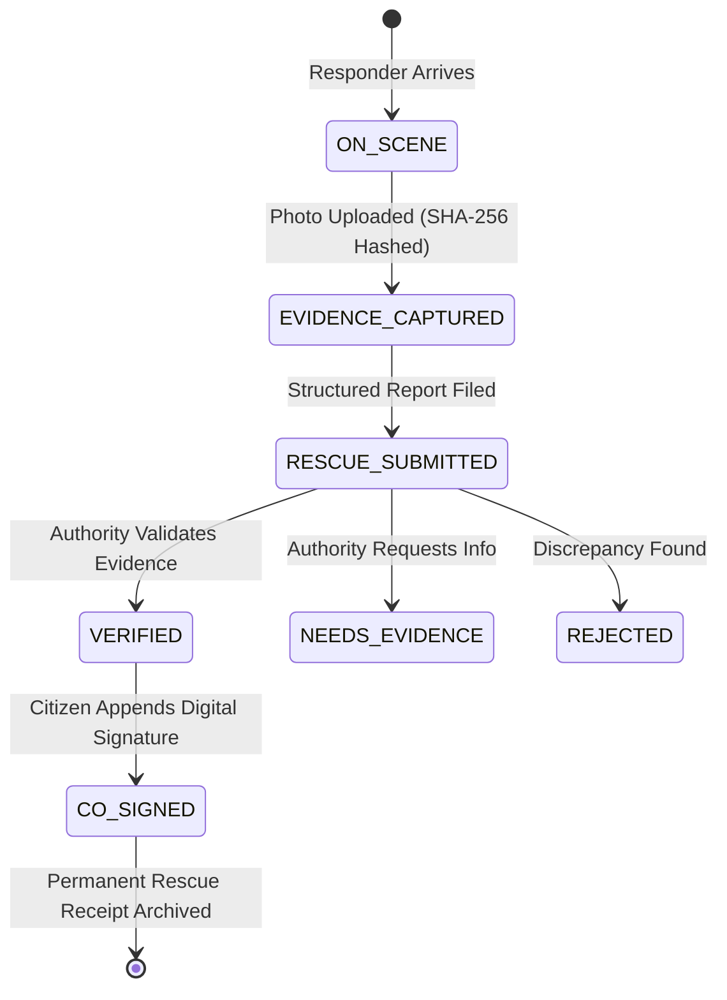

# Phase 3 — Verified Rescue & Cryptographic Evidence Workflow

## 1. What Was Built

Phase 3 delivers **Feature 3: Verified Rescue (Evidence + Dual Confirmation)**:
1. **On-Scene Arrival Recording**:
   - Responder marks `[ ON SCENE ]` or `[ ARRIVED ]`.
   - Immutable capture of arrival timestamp, responder identity, incident ID, and GNSS coordinates.
2. **Cryptographic Evidence Capture**:
   - Tactical photo/video upload.
   - SHA-256 integrity hash calculated client-side via `crypto.subtle.digest('SHA-256', arrayBuffer)` before transmission.
   - Evidence records stored in `evidence` table with filename, size, MIME type, hash, and capture location.
3. **Structured Rescue Report**:
   - Responder submits operational report: patients treated, extraction outcome (`RESCUED`), summary notes, and responder digital signature.
   - Incident transitions from `ON_SCENE` to `RESCUE_SUBMITTED`.
4. **Authority Verification Desk**:
   - Authority Incident Commander reviews case: responder credentials (`VALID`), arrival timeline, location consistency, and photo preview with verified SHA-256 digest.
   - Three operational review actions:
     - `[ VERIFY RESCUE & ISSUE CERTIFICATE ]`: Updates status to `VERIFIED`, closes incident, frees responder profile.
     - `[ REQUEST MORE EVIDENCE ]`: Requests additional on-scene proof.
     - `[ REJECT REPORT ]`: Flags discrepancies.
   - **Strict RBAC Enforcement**: Citizens or unauthorized actors attempting to call `verify-rescue` directly are rejected with HTTP 403 Forbidden.
5. **Citizen Dual-Confirmation Co-Signing**:
   - Citizen co-signs the digital rescue receipt upon safe evacuation (`POST /api/v1/incidents/:id/confirm-rescue`).
   - Appends victim digital signature to the permanent rescue receipt.
6. **Immutable Flight Recorder Audit Chain**:
   - Every transition is cryptographically chained into `audit_events`:
     $$H_n = \text{SHA-256}(H_{n-1} \parallel \text{Timestamp} \parallel \text{Actor} \parallel \text{Action} \parallel \text{ObjectID})$$
   - Real-time Merkle verification verifies zero tampering across all historical events.

---

## 2. Verified Rescue State Machine



---

## 3. Files Changed & Implemented

- `apps/web-console/index.html`: `#sub-verification`, `#citizen-dual-confirm-box`, Evidence upload form.
- `apps/web-console/app.js`: `setupEvidenceUpload()`, `verifyRescue()`, `confirmRescue()`, `renderVerificationReview()`.
- `apps/api/server.js`: `/api/v1/incidents/:id/evidence`, `/api/v1/incidents/:id/rescue-report`, `/api/v1/incidents/:id/verify-rescue`, `/api/v1/incidents/:id/confirm-rescue`, `/api/v1/rescue/receipts`.
- `tests/test_backend_api.py`: Automated tests covering evidence upload, rescue reporting, 403 RBAC rejection, authority verification, and citizen co-signing.

---

## 4. API Endpoints Reference

| Method | Endpoint | Authorized Roles | Description |
|---|---|---|---|
| `POST` | `/api/v1/incidents/:id/evidence` | `RESPONDER` | Uploads on-scene photo/video evidence with SHA-256 hash |
| `POST` | `/api/v1/incidents/:id/rescue-report` | `RESPONDER` | Submits structured rescue outcome and patients treated |
| `POST` | `/api/v1/incidents/:id/verify-rescue` | `AUTHORITY`, `ADMIN` | Verifies rescue evidence and marks incident `VERIFIED` (403 for Citizens) |
| `POST` | `/api/v1/incidents/:id/confirm-rescue` | `CITIZEN` | Victim co-signs rescue receipt with digital signature |
| `GET` | `/api/v1/audit/flight-recorder` | All Roles | Verifies integrity of append-only cryptographic audit chain |

---

## 5. Automated Tests & Verification

- `tests/test_backend_api.py`: 4 tests passed, verifying the complete end-to-end rescue and verification lifecycle.
- `tests/test_credentials_and_receipts.py`: Verified W3C Verifiable Credentials and Rescue Receipts.
- `tests/test_audit.py`: Verified Flight Recorder hash-chain verification and tamper detection.

---

## 6. How to Run & Reproduce

```powershell
# 1. Start Server
node apps/web-console/server.js

# 2. Window A: Login as Capt. Vikram Singh (RESPONDER)
#    Under "Evidence & Report", upload a photo (e.g. on_scene.jpg).
#    Notice SHA-256 hash calculated in real-time.
#    Tap "Submit Rescue Report to Authority".

# 3. Window B: Login as Commander Rajesh Kumar (AUTHORITY)
#    Under "Command Overview" -> "Rescue Verification Desk".
#    Notice the rescue report card with photo preview and SHA-256 hash.
#    Tap "Verify Rescue & Issue Certificate".

# 4. Window C: Login as Priya Sharma (CITIZEN)
#    Notice Stepper transitions to VERIFIED.
#    Dual-confirmation banner appears: Tap "Confirm Rescue & Co-Sign Receipt".
```
