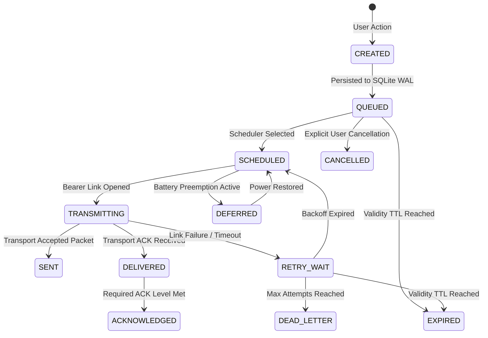

# UrSafe / Cascade26 Rescue Continuity Engine Specification
## Phase 4 Production-Grade Distributed Messaging Architecture

---

## 1. Executive Summary
The **Rescue Continuity Engine** is the core offline-first store-and-forward subsystem of UrSafe. It guarantees that emergency messages survive complete telecommunication infrastructure failure, intermittent radio connectivity, network partitions, device reboots, and application crashes.

The non-negotiable architectural invariant is:
> **An emergency message must continue attempting delivery through every viable communication path until its delivery policy is satisfied or its validity expiration is reached, without losing, duplicating, corrupting, falsely acknowledging, or silently abandoning the emergency.**

---

## 2. Canonical Message Model
Every packet moving through the continuity engine adheres to the canonical envelope:
```json
{
  "id": "cmsg-9c8e2b10-6a54-4f51-b87c-1792959945",
  "message_id": "msg-m7b62-fa91d3",
  "incident_id": "inc-2026-00042",
  "sender_device_id": "dev-pixel8-node14",
  "sender_user_id": "usr-citizen-01",
  "recipient_scope": "BROADCAST",
  "message_type": "SOS_CREATE",
  "priority": 0,
  "created_at": 1792959945000,
  "expires_at": 1793046345000,
  "sequence_number": 1,
  "payload_json": "{\"emergency_type\":\"TRAPPED\",\"victim_count\":3}",
  "payload_hash": "18d1faa7c58baa5fecc5681b5644672262132e85242f03a835969ba5754c1826",
  "delivery_policy_json": "{\"max_attempts\":10,\"required_ack\":\"NODE_ACK\"}",
  "current_state": "ACKNOWLEDGED",
  "attempt_count": 1,
  "last_attempt_at": 1792959945476,
  "next_retry_at": 0,
  "last_transport": "tr-ble-01",
  "last_error": null,
  "ack_level": "NODE_ACK",
  "completed_at": 1792959945510
}
```

---

## 3. Priority Classes & Preemption Hierarchy
Traffic is categorized into 6 strict priority levels:
- **P0 — LIFE CRITICAL (0)**: SOS distress signals, trapped individuals, imminent danger, responder distress. Preempts all other traffic unconditionally.
- **P1 — EMERGENCY CONTROL (1)**: Incident cancellations, severity escalations, command assignments.
- **P2 — RESPONDER OPERATION (2)**: Mission acceptance, en-route telemetry, on-scene arrival beacons.
- **P3 — SAFETY & LOCATION (3)**: Geographic coordinate updates, hazard perimeter alerts, civilian safety check-ins.
- **P4 — NORMAL MESSAGE (4)**: Inter-responder operational chat and notes.
- **P5 — TELEMETRY / BACKGROUND (5)**: Heartbeat pings, battery diagnostics, mesh route advertisements.

### Preemption Rules
1. Inbound dispatch queue orders strictly by: `priority ASC, next_retry_at ASC, created_at ASC`.
2. A queue containing 1,000 P5 telemetry pings and 1 P0 SOS will dispatch the P0 SOS first.
3. Under critical battery conditions (<= 15%), P3-P5 transmissions are automatically placed in `DEFERRED` state to conserve power for life-critical P0-P1 traffic.

---

## 4. Delivery State Machine (13 States)


---

## 5. Acknowledgement Semantics & User Phrasing
UrSafe enforces truth in advertising. The UI never indicates "Help Received" upon a transport-level broadcast.
| ACK Level | Technical Meaning | User Phrasing in Cockpit |
| :--- | :--- | :--- |
| `NONE` | Stored on local device only | *"Saved on your device. Searching for emergency paths."* |
| `TRANSPORT_ACK` | Local radio/bearer accepted frame | *"Sent over emergency radio (awaiting mesh receipt)."* |
| `NODE_ACK` | Nearby mesh relay node confirmed receipt | *"Received and validated by a mesh relay node."* |
| `APPLICATION_ACK` | Recipient UrSafe app parsed message | *"Received by responder device application."* |
| `HUMAN_ACK` | Human responder explicitly accepted | *"Responder has accepted and verified your emergency."* |

---

## 6. Crash Recovery Protocol (Section 13)
When the application crashes or the device is rebooted mid-transmission:
1. On boot, `recoverOutboxOnBoot()` queries for any message where `current_state IN ('TRANSMITTING', 'SCHEDULED')`.
2. These messages are atomically updated to `current_state = 'RETRY_WAIT'`, `next_retry_at = 0`, and `last_error = 'RECOVERED_AFTER_PROCESS_RESTART'`.
3. The background dispatcher immediately re-queues them for transmission.
4. Duplicate transmissions arriving at peers are intercepted by `continuity_deduplication` and handled idempotently without re-triggering business mutations.
