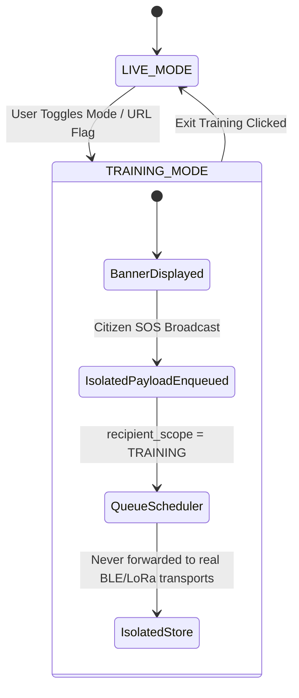

# UrSafe UI Specification: Truthful Offline Architecture & Evolutionary Map

> **Standard:** Real emergency communications must NEVER display plausible fake numbers, artificial statuses ("OPTIMAL"), or fabricated wireless links. Where real telemetry exists, bind it dynamically; where unavailable, display `"No data yet"` or a clear disconnected state.

---

## 1. Executive Summary & Design System Changes

| Element | Old (Fabricated Demo) | New (Truthful Production Mesh) | Technical Data Source |
| :--- | :--- | :--- | :--- |
| **Header Radio Band** | `Local 868MHz // Peers: 04 // RSSI: -72dBm` | `REGION: IN_865 // Transports: Initializing` | Bound to active `RadioManager` / `continuity_transports` table |
| **Global Training Banner** | *None* | Full-width sticky `#training-mode-banner` across all views | Bound to `AppState.mode === 'TRAINING'`; blocks delivery scheduler |
| **Role Access Switcher** | Unrestricted 1-click switcher in production | Gated behind `window.URSAFE_CONFIG.isDev` flag | Hidden in release; visible only when `NODE_ENV !== 'production'` |
| **Landing Node Badge** | `12,408 Neighbor-Nodes Active Worldwide` | `Local Offline Mesh Active • IN_865` | Real discovered BLE/LoRa peer count from `mesh_nodes` |
| **Landing Hero Tag** | `100% OFF-GRID READY` | `OFFLINE CAPABLE MESH` | Removed misleading 100% guarantee; reflects actual link availability |
| **Victim Mesh Health** | `OPTIMAL` | `No data yet` / dynamic hop counter | `GET /api/v1/continuity/cockpit` |
| **Distress Text Counter** | `82 / 240 chars (LoRa Packet Optimized)` | `0 / 200 bytes (LoRa Payload Budget)` | Live `TextEncoder().encode(val).length / 200 bytes` |
| **Initial Severity** | Pre-selected `URGENT` | `null` (UNSET) | Victim must explicitly declare urgency; prevents accidental false dispatch |
| **Triage Distance & Hops** | Hardcoded `0.8 KM`, `HOP: 01` | Computed Haversine distance (`-- KM` if missing), `HOP: N` | Real GPS coordinates and message envelope hop count |
| **Simulated Data Tagging** | Indistinguishable from real incidents | Visible `[SIMULATED]` badge chip | Seed incidents only appear in `TRAINING` mode |
| **Responder BLE UUID** | `BLE (0xFFF0)` | `BLE (Meshtastic)` | Bound to official Meshtastic Service UUID `6ba1b218-15a8-461f-9fa8-5dcae273eafd` |
| **Responder Vector Canvas** | Hardcoded SVG overlay with `0.4 KM`, `R-01` | Real Leaflet tactical viewport (`#map-responder-viewport`) | Real coordinates of verified incidents and authenticated responders |
| **Authority Strip Metrics** | `94.2%`, `128 ACTIVE NODES`, `76%`, `High/Stable` | `TRANSPORTS ONLINE`, `ACTIVE NODES`, `AVG BATTERY`, `SIGNAL QUALITY` | Bound to `SELECT COUNT(*) FROM mesh_nodes WHERE last_seen_at > now - 5m` |
| **Authority Clusters** | Fabricated card: `12`, `28`, `88` | **REMOVED** | Replaced with real query sections |
| **Authority Mesh Overlay** | Decorative SVG polygon and dashed lines | **REMOVED** | Replaced with real map plotting and graph reachability |
| **Authority Section Rails** | Single conflated mock rail | **3 Separate Query Sections** | 1. Priority counts, 2. Node roles/states, 3. Partitions & Outbox |
| **Bottom Ticker** | `PEER-ROUTER v2.4.19 • US915 • B-77 • 14,892/814` | `TACTICAL COORDINATOR v1.0.0 • IN_865 • LOCAL AD-HOC` | Real software version, regulatory band, and packet counters |

---

## 2. Screen-by-Screen View Specifications

### View 1: Landing & Persona Selection (`#view-landing`)
- **Status Badge:** Displays `"Local Offline Mesh Active • IN_865"`.
- **Role Switcher (`#quick-role-eval`):**
  - Controlled by `window.URSAFE_CONFIG.isDev` (injected via `/config.js` or `GET /api/v1/config`).
  - When visible, marked with `(DEV / TEST ONLY)`.
  - When clicked, invokes real `POST /api/v1/auth/login` and stores the authenticated JWT token in `AppState.currentUser.session.token`.

### View 2: Victim Portal (`#view-victim`)
- **Local Mesh Health:** Shows `"Hops: No data yet"` and status `"No data yet"`. When connected to a radio, displays measured hop count.
- **Transports Pill Group:** Real state of BLE (`ACTIVE` / `OFFLINE`), LoRa (`IN_865 ACTIVE` / `OFFLINE`), Cloud (`ONLINE` / `CLOUD OFFLINE`).
- **Emergency Situation Details:**
  - Empty textarea placeholder with no pre-filled text.
  - Strict 200-byte budget counter: `new TextEncoder().encode(text).length / 200 bytes`.
  - Adds `.over-budget` red highlight if payload exceeds 200 bytes.
- **Triage Urgency Selection:** Starts completely unselected (`null`). Victim must click `CRITICAL`, `URGENT`, or `STANDARD`.
- **Duplicate Prevention:** Form submission includes client-generated unique `client_msg_id`. Retrying submission returns `{ deduplicated: true }` without inserting duplicates.

### View 3: Responder Portal (`#view-responder`)
- **Tactical Map Viewport:**
  - Hardcoded SVG canvas removed.
  - Interactive Leaflet map container (`#map-responder-viewport`) rendering authenticated responder location and active incidents.
- **Triage Queue Cards:**
  - In `LIVE` mode: only real incidents from `GET /api/v1/incidents` are rendered.
  - In `TRAINING` mode: simulated scenarios are displayed with an unmistakable `[SIMULATED]` gold badge chip.
  - Distance: Computed dynamically using Haversine formula from responder GPS. Displays `"-- KM (N/A)"` if either coordinate is missing.
  - Hops: Bound to message envelope hop count (or `"Direct"` if 0).
- **Bearer Diagnostics Card:**
  - Displays actual RSSI and SNR or `"No data yet"`.
  - BLE shows `"BLE (Meshtastic)"` and status `"DISCONNECTED"` until GATT connected.
  - Outbox queue shows live pending count from `GET /api/v1/continuity/cockpit`.

### View 4: Authority / Global Dashboard (`#view-dashboard`)
Divided into three independent query sections backed by isolated API endpoints:
1. **Section 1: Incidents by Priority (`#section-incidents-priority`)**
   - Query: `GET /api/v1/incidents?all=true`
   - Real count of active incidents grouped by urgency: `CRITICAL`, `URGENT`, `STANDARD`.
   - Displays real unresolved count.
2. **Section 2: Network Nodes by Role & State (`#section-nodes-breakdown`)**
   - Query: `GET /api/v1/mesh`
   - Groups hardware nodes by role: `ROUTER / RELAY`, `CLIENT / PEER`, `OFFLINE / UNKNOWN`.
   - Displays active node count (nodes seen within last 5 minutes).
3. **Section 3: Partitions & Outbox Backpressure (`#section-partitions-breakdown`)**
   - Query: `GET /api/v1/continuity/cockpit`
   - Active transports count (0 to 3).
   - Outbox pending messages count.
   - Topology reachability status: `"REDUNDANT MESH"` ($\ge 2$ transports), `"SINGLE CARRIER"` (1 transport), or `"ISOLATED LOCAL CELL"` (0 transports).
   - Store-and-forward indicator showing data mule readiness.

---

## 3. Training Mode Isolation Lifecycle



1. **Visual Indication:** Full-width `#training-mode-banner` rendered at top of DOM (`position: sticky`, `z-index: 10000`).
2. **Delivery Guard:** Enforced in `continuity.js` scheduler:
   ```javascript
   if (isTraining || msg.recipient_scope === 'TRAINING') {
     db.prepare("UPDATE continuity_messages SET current_state = 'DELIVERED', next_step = 'SIMULATION_ISOLATED'...").run(...);
     return; // NEVER forwarded to hardware transports
   }
   ```
3. **Data Labeling:** All training cards render `.badge-simulated` chip.

---

## 4. Banned Literals & Automated Static CI Checks

The following literals are permanently forbidden in any user-facing code or service default:

| Banned Literal | Reason | Replacement |
| :--- | :--- | :--- |
| `14,892` | Fabricated packet counter in bottom ticker | Live counter or `"No data yet"` |
| `12,408` | Fabricated node count on landing page | `"Local Offline Mesh Active • IN_865"` |
| `B-77` | Fabricated radio tower gateway in ticker | `"LOCAL AD-HOC"` |
| `94.2` | Fabricated mesh integrity percentage | Real active transport count |
| `99.4` | Fabricated LQI in responder card and toast | Measured SNR/RSSI or `"No data yet"` |
| `OPTIMAL` | Subjective, false claim of network perfection | Real measured transport status |
| `100% OFF-GRID` | False claim; depends on battery, radios, and topology | `"OFFLINE CAPABLE MESH"` |
| `US915` | Wrong frequency band for India (865–867 MHz) | `IN_865` |
| `0xFFF0` | Invalid 16-bit UUID placeholder | Official Meshtastic UUID `6ba1b218-15a8-461f-9fa8-5dcae273eafd` |

Automated enforcement: `tests/test_truthfulness_linter.py` runs on every CI commit and asserts 0 violations.
